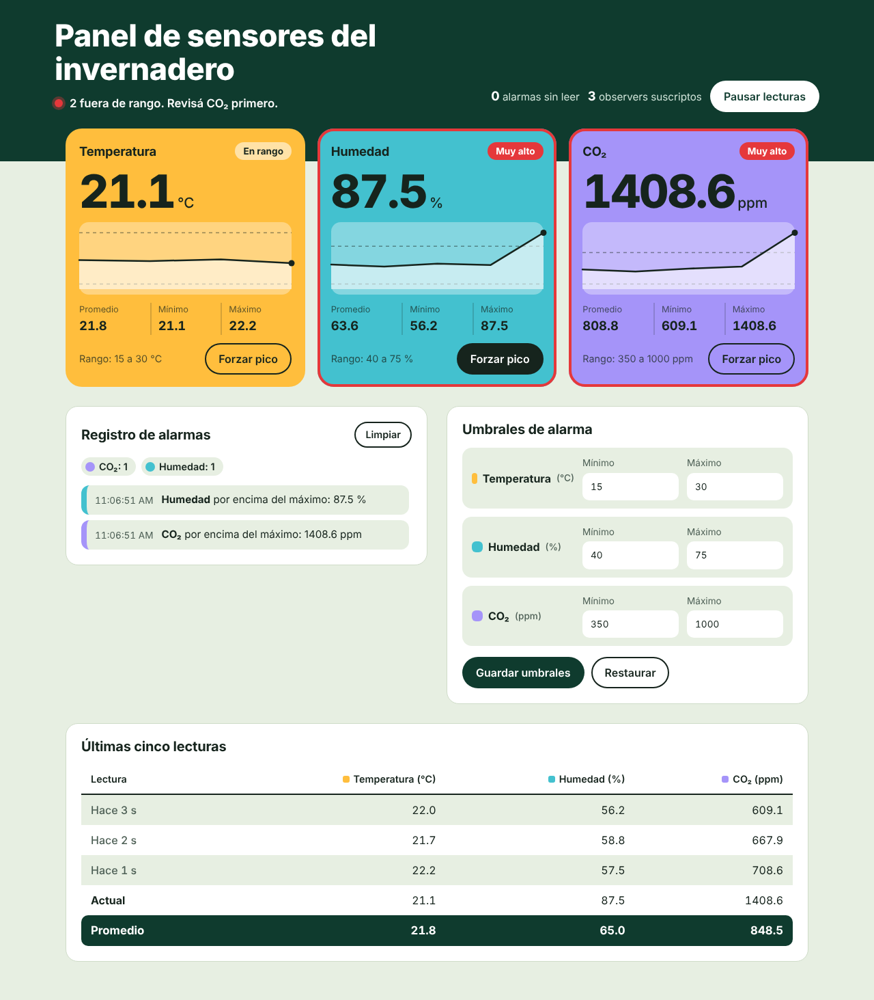

# Panel de sensores del invernadero

Panel de monitoreo en React para un invernadero. Simula tres sensores (temperatura, humedad y CO₂) que envían una lectura por segundo, muestra la evolución de cada uno, genera alarmas cuando un valor sale del rango permitido y permite configurar esos rangos.

Proyecto final de **Programación Web** — ITU, Mendoza.



## Funcionalidades

- **Lecturas en tiempo real** de tres sensores simulados, con valor actual, gráfico de las últimas 30 lecturas y promedio, mínimo y máximo.
- **Alarmas** cuando un sensor pasa a estar fuera de rango. El registro muestra la más nueva primero, cuenta las alarmas por sensor y marca como leídas las que ya se vieron en pantalla.
- **Umbrales configurables** por sensor, con validación y guardado en el navegador (`localStorage`).
- **Forzar pico** en cualquier sensor, para probar las alarmas durante una demostración.
- **Pausar y reanudar** las lecturas.
- **Matriz de lecturas**: las últimas cinco lecturas de los tres sensores y el promedio de cada columna.
- Diseño adaptable a celular.

## Tecnologías

| | |
| --- | --- |
| Interfaz | React 18 |
| Herramienta de desarrollo | Vite 5 |
| Gráficos | SVG hecho a mano, sin librerías |
| APIs del navegador | ResizeObserver, IntersectionObserver, localStorage |

No usa librerías externas aparte de React.

## Cómo correrlo

Requisitos: [Node.js](https://nodejs.org/) 18 o más nuevo.

```bash
git clone https://github.com/ZogeGBR/PanelSensoresInvernadero.git
cd PanelSensoresInvernadero
npm install
npm run dev
```

La app queda en `http://localhost:5173`.

| Comando | Qué hace |
| --- | --- |
| `npm run dev` | Servidor de desarrollo con recarga automática |
| `npm run build` | Genera la versión de producción en `dist/` |
| `npm run preview` | Sirve localmente la versión de `dist/` |

> Las tipografías (Bricolage Grotesque y Figtree) se cargan desde Google Fonts. Sin internet, el panel funciona igual con la fuente del sistema.

## Estructura

```
src/
├── main.jsx                 Punto de entrada: monta <App /> en modo estricto
├── App.jsx                  Estado principal: umbrales, alarmas y pausa
├── estilos.css              Estilos y paleta de colores
├── sensores/
│   ├── Sensor.js            Clase Sensor (Subject del patrón Observer)
│   └── simulador.js         Crea los sensores y genera lecturas
├── hooks/
│   ├── useLecturas.js       Conecta React con los sensores (useSyncExternalStore)
│   ├── useTamanio.js        Mide un elemento (ResizeObserver)
│   ├── useEnPantalla.js     Detecta si un elemento se ve (IntersectionObserver)
│   └── useLocalStorage.js   Estado que se guarda en el navegador
├── utils/
│   └── estadisticas.js      Funciones puras de cálculo
└── componentes/             Componentes visuales del panel
```

El detalle de la arquitectura, las decisiones de diseño y las tareas pendientes están en el [informe del proyecto](docs/INFORME.md).

## Autora

Zoe Garcia Badiola — [github.com/ZogeGBR](https://github.com/ZogeGBR)
