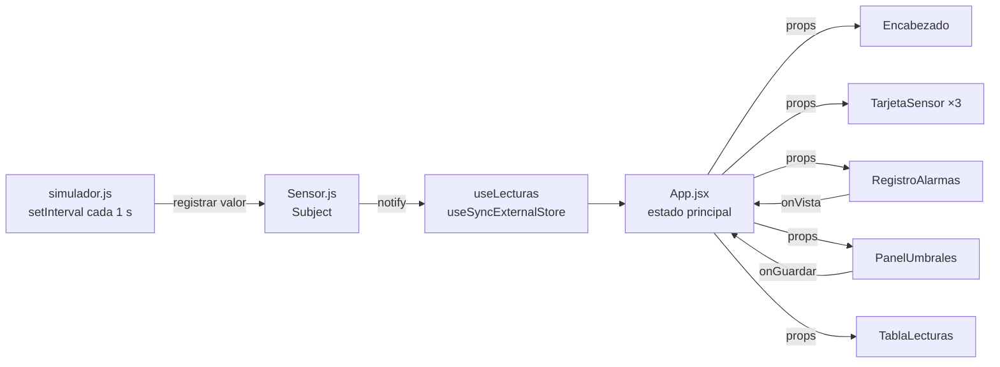

# Informe del proyecto: Panel de sensores del invernadero

Informe para el equipo: qué es el proyecto, cómo está organizado, cómo trabajamos sobre el repositorio y qué falta hacer antes de la defensa.

## 1. Resumen

Es una aplicación en React que simula tres sensores de un invernadero (temperatura, humedad y CO₂). Cada segundo llega una lectura nueva. El panel muestra el valor actual y la evolución de cada sensor, avisa cuando un valor sale del rango permitido y deja configurar esos rangos.

El proyecto está pensado para el final de Programación Web: cada tema del semestre aparece en un lugar concreto del código (ver la sección 5), así que cualquier pregunta teórica se puede responder mostrando el archivo.

**Estado actual:** la aplicación está completa y funciona. Se probó en Chromium, de escritorio y de celular: lecturas, alarmas, validación del formulario, pausa y contador de observers (queda en 3 con StrictMode activo), sin errores en consola. Lo que falta es preparación para la defensa y mejoras opcionales (sección 7).

## 2. Cómo correrlo

```bash
npm install
npm run dev     # http://localhost:5173
```

Necesita Node.js 18 o más nuevo. Más detalle en el [README](../README.md).

## 3. Cómo viajan los datos

Los datos van siempre en una dirección: del simulador a los sensores, de los sensores a React, y de `App` a los componentes por props.



Paso a paso:

1. **`simulador.js`** genera un valor nuevo por sensor cada segundo y llama a `sensor.registrar(valor)`.
2. **`Sensor.js`** guarda la lectura en un array nuevo y hace `notify()`: avisa a todos sus observers.
3. **`useLecturas`** es uno de esos observers. Usa `useSyncExternalStore` para que React vuelva a renderizar cuando un sensor cambia.
4. **`App.jsx`** recibe las lecturas, detecta alarmas comparándolas con los umbrales y reparte todo a los componentes por props.
5. Los componentes **sólo dibujan**. Cuando el usuario hace algo (guardar umbrales, ver una alarma), avisan a `App` con una función que recibieron por props (`onGuardar`, `onVista`).

## 4. Qué hace cada archivo

| Archivo | Responsabilidad |
| --- | --- |
| `src/main.jsx` | Monta `<App />` dentro de `React.StrictMode` |
| `src/App.jsx` | Guarda el estado (umbrales, alarmas, pausa), arranca y detiene el simulador, detecta alarmas |
| `src/sensores/Sensor.js` | Clase Sensor: `subscribe`, `unsubscribe`, `notify`, getter `observerCount`, historial de 30 lecturas |
| `src/sensores/simulador.js` | Crea los tres sensores, genera lecturas, `forzarPico`, y las funciones que usa `useSyncExternalStore` |
| `src/hooks/useLecturas.js` | Conecta React con los sensores |
| `src/hooks/useTamanio.js` | ResizeObserver: da el ancho del gráfico |
| `src/hooks/useEnPantalla.js` | IntersectionObserver: marca una alarma como leída cuando se ve |
| `src/hooks/useLocalStorage.js` | Como `useState`, pero guardado en el navegador |
| `src/utils/estadisticas.js` | Funciones puras: promedio, mínimo, máximo, estado, desvío, conteo de alarmas, matriz |
| `src/componentes/Encabezado.jsx` | Estado general, alarmas sin leer, observers, botón de pausa |
| `src/componentes/TarjetaSensor.jsx` | Valor, gráfico y resumen de un sensor |
| `src/componentes/Grafico.jsx` | Gráfico de línea en SVG que se adapta a su ancho |
| `src/componentes/RegistroAlarmas.jsx` | Lista de alarmas y conteo por sensor |
| `src/componentes/Alarma.jsx` | Una alarma; avisa cuando fue vista |
| `src/componentes/PanelUmbrales.jsx` | Formulario controlado para los rangos de cada sensor |
| `src/componentes/TablaLecturas.jsx` | Matriz de las últimas cinco lecturas con promedio por columna |
| `src/estilos.css` | Paleta, tipografía y diseño adaptable |

## 5. Temas de la materia y dónde están

| Tema | Dónde está |
| --- | --- |
| Patrón Observer (`subscribe`, `unsubscribe`, `notify`, getter) | `sensores/Sensor.js` |
| Estado externo con `useSyncExternalStore` | `hooks/useLecturas.js`; `suscribirATodos` y `leerFoto` en `simulador.js` |
| ResizeObserver en un custom hook | `hooks/useTamanio.js`, usado en `Grafico.jsx` |
| IntersectionObserver en un custom hook | `hooks/useEnPantalla.js`, usado en `Alarma.jsx` |
| `useEffect` con limpieza | Simulador en `App.jsx`; los tres hooks de observers |
| `map` | `valores()` y todas las listas de componentes |
| `filter` | Sensores fuera de rango (`Encabezado.jsx`) y alarmas sin leer (`App.jsx`) |
| `reduce` | `promedio`, `minimo`, `maximo`, `contarPorSensor` y total de observers |
| `sort` sobre una copia | Sensor más comprometido (`Encabezado.jsx`) y alarmas más nuevas primero |
| `every` | Estado general, validación de umbrales y caché de `leerFoto` |
| Objetos, `Object.entries` / `fromEntries`, spread | Umbrales, `PanelUmbrales.jsx`, `leerFoto` |
| Matrices y `for` anidados | `armarMatriz` y `promedioPorColumna` en `estadisticas.js` |
| Componentes, props y estado levantado | `App.jsx` guarda el estado y lo pasa a los hijos |
| Formulario controlado | `PanelUmbrales.jsx` |
| Renderizado condicional y listas con `key` | Todos los componentes |
| `useRef` y `useCallback` | `estadosPrevios` y `marcarVista` en `App.jsx` |
| Seguridad (XSS) | React escapa el texto como `textContent`; no se usa `dangerouslySetInnerHTML` |

## 6. Decisiones de diseño

- **Sensores fuera de React.** El simulador y la clase `Sensor` son JavaScript puro; React sólo se suscribe. Así el patrón Observer se ve completo y se podría reemplazar el simulador por sensores reales sin tocar los componentes.
- **Un array nuevo en cada lectura.** `registrar` crea un array nuevo en vez de hacer `push`, porque React detecta los cambios comparando referencias.
- **`leerFoto` devuelve el mismo objeto si nada cambió.** Si devolviera uno nuevo en cada llamada, React entraría en un bucle de renders.
- **Una alarma por cambio de estado, no por segundo.** `App` recuerda el último estado de cada sensor en un `useRef` y sólo registra la alarma cuando un sensor pasa de "en rango" a "fuera de rango".
- **Componentes que sólo dibujan.** Los cálculos están en `utils/estadisticas.js` como funciones puras, fáciles de probar y de explicar.
- **El color de cada sensor está en una sola variable CSS** (`--color-sensor`), que cambia según la clase `sensor-temperatura`, `sensor-humedad` o `sensor-co2`.

## 7. Tareas pendientes

### Para la defensa (prioridad alta)

- [ ] Leer el código completo y que cada integrante pueda explicar cualquier archivo
- [ ] Armar la guía de defensa: explicación por archivo y preguntas teóricas probables con respuesta
- [ ] Repartir qué explica cada integrante y ensayar la demostración con cronómetro
- [ ] Definir el guion de la demo: lecturas en vivo, forzar un pico, ver la alarma, cambiar un umbral, pausar
- [ ] Revisar la consigna de la cátedra y confirmar que el proyecto cumple todo lo pedido
- [ ] Probar el proyecto en la computadora que se va a usar en el examen (`npm install` y `npm run dev`)
- [ ] Tener una copia del proyecto con `node_modules` instalado por si no hay internet en el aula

### Mejoras recomendadas (prioridad media)

- [ ] Incluir las tipografías en el proyecto para que se vean igual sin internet
- [ ] Agregar pruebas unitarias de `utils/estadisticas.js` con Vitest
- [ ] Agregar ESLint con las reglas de React Hooks
- [ ] Publicar el panel en GitHub Pages o Netlify para mostrarlo con un link (la configuración `base: "./"` ya está lista)

### Extras opcionales (sólo si sobra tiempo)

- [ ] Guardar el historial de alarmas en `localStorage`
- [ ] Exportar las lecturas a un archivo CSV
- [ ] Conectar con el backend de las prácticas a6_1 (servlets y MySQL) para guardar las alarmas
- [ ] Sumar un cuarto sensor (por ejemplo, luz) para mostrar que agregarlo no toca los componentes

## 8. Cómo trabajamos en el repositorio

- **Ramas:** cada tarea en su propia rama (`feature/tipografias-locales`, `docs/guia-defensa`), nunca directo sobre `main`.
- **Pull requests:** se abre un PR a `main` y otro integrante lo revisa antes de unirlo.
- **Mensajes de commit:** en español, con un prefijo que diga el tipo de cambio:

| Prefijo | Para qué |
| --- | --- |
| `feat:` | Funcionalidad nueva |
| `fix:` | Corrección de un error |
| `docs:` | Documentación |
| `style:` | Estilos o formato, sin cambiar la lógica |
| `refactor:` | Reorganizar código sin cambiar lo que hace |
| `chore:` | Configuración y dependencias |

- **Código:** comentarios en español, nombres en español y 4 espacios de sangría (lo aplica `.editorconfig`).
